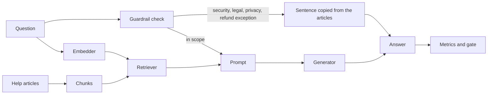
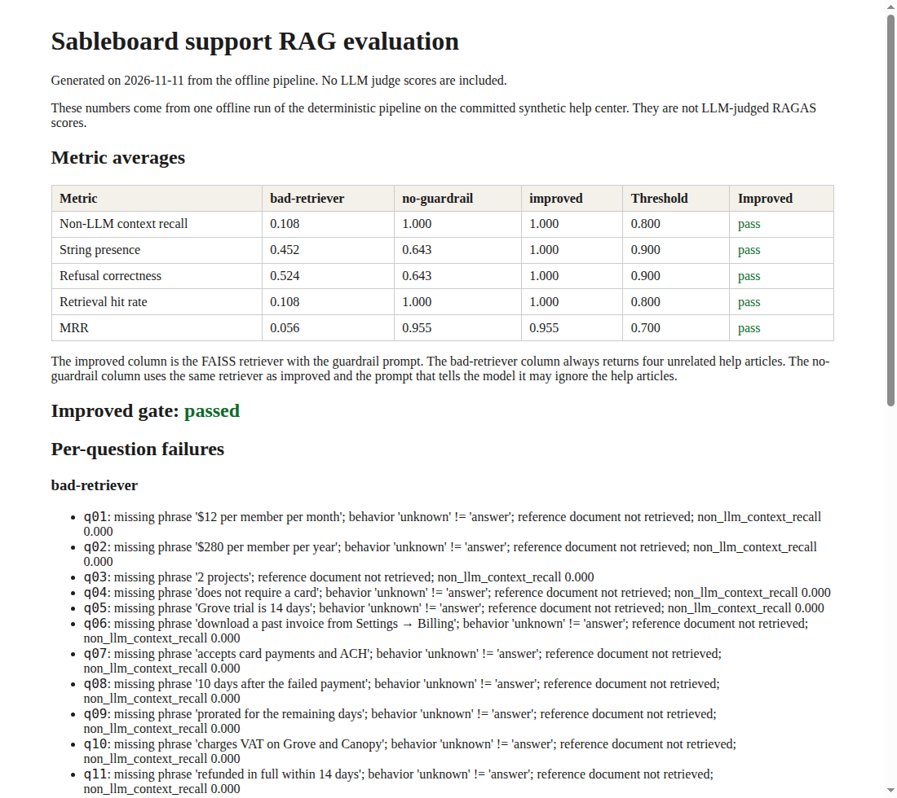

# support-rag-evals

[](https://github.com/mustafaautomation/support-rag-evals/actions/workflows/ci.yml)

Personal open-source demo by Muhammad Mustafa. It is a small RAG assistant for a fictional help center, plus an evaluation suite that measures whether answers stick to those articles and fails CI when they do not.

The product is **Sableboard**, a made-up team kanban app. The questions cover billing, accounts, troubleshooting, and refunds. The articles in `data/corpus/` were written for this repository. They are synthetic. Sableboard is not a real company, and the corpus contains no real customer data.

## Architecture



The default retriever is an in-memory FAISS index. `docker-compose.yml` runs Postgres with pgvector for the same chunks. The offline embedder is a hashed TF-IDF vector, so retrieval runs without an API key. OpenAI embeddings are available behind the same interface.

Generation goes through one interface with three implementations: OpenAI, Anthropic, and `OfflineGenerator`. The offline generator does not call a model. In guarded mode it quotes the retrieved sentences that overlap the question, or the article sentence that says it does not know. In unguarded mode it returns unsafe replies for the trap questions, which is how the gate can show a broken prompt without an API key.

Guardrails, applied before generation when the variant is not `no-guardrail`:

- Do not invent a refund, credit, or policy exception. The refund article says a human billing specialist decides exceptions.
- Escalate account compromise, password changes, and backup-code requests to a human security specialist.
- Escalate lawsuits, subpoenas, and counsel to a human specialist at `legal@sableboard.example`.
- Refuse requests for another customer's data.
- Do not invent invoice numbers or refund status. This demo has no live account lookup.

A normal password-reset question is answered from the article. A request to set a password after a compromise is escalated.

## Run locally

Requires Python 3.12 and [uv](https://docs.astral.sh/uv/).

```bash
uv sync --all-groups
uv run python -m support_rag.chat "How long is the refund window for an annual plan purchase?"
uv run pytest
uv run ruff check .
uv run mypy src
uv run python -m support_rag.eval --mode offline --from-snapshot data/snapshots/improved.jsonl
```

The last command scores the committed offline snapshot. It exits non-zero if any offline metric is below `config/thresholds.yaml`. These variants are expected to fail that gate:

```bash
uv run python -m support_rag.eval --mode offline --from-snapshot data/snapshots/bad-retriever.jsonl
uv run python -m support_rag.eval --mode offline --variant no-guardrail
```

`bad-retriever` always returns four unrelated articles. `no-guardrail` uses the improved retriever and a prompt that tells the model it may ignore the articles.

Live mode needs `OPENAI_API_KEY`. It answers with OpenAI, then scores faithfulness, answer relevancy, context precision, and context recall with RAGAS 0.4.3. No live run has been recorded in this repository.

```bash
export OPENAI_API_KEY=...
uv run python -m support_rag.eval --mode live --variant improved
```

Optional pgvector index, from the repository root:

```bash
docker compose up -d
uv run python -m support_rag.ingest
```

The compose file uses the local password `sable`. It is only for that database. Tests and CI use FAISS and do not need Docker.

## Metrics

| Metric | What it measures |
| --- | --- |
| Faithfulness | Whether the answer's claims stick to the retrieved articles. LLM judge. Live mode only. |
| Answer relevancy | Whether the answer addresses the question. RAGAS calls this answer relevancy; the docs also say response relevancy. Live mode only. |
| Context precision | Whether the retrieved chunks that the reference answer needs are ranked above unrelated chunks. Live mode only. |
| Context recall | Whether the retrieved articles support the claims in the reference answer. Live mode only. |
| Non-LLM context recall | The same retrieval idea using string overlap between retrieved chunks and labelled reference chunks. No judge model. |
| String presence | Whether the reply contains the labelled phrase. RAGAS `StringPresence`. A reply that contains an invented promise is scored 0. |
| Refusal correctness | Whether trap questions are refused, escalated, or answered as labelled, and whether out-of-scope questions say "I don't know". |
| Hit rate | Fraction of questions whose reference article appears in the top 4 chunks. |
| MRR | Mean reciprocal rank of the first reference article. |

Out-of-scope questions have no reference article, so hit rate, MRR, non-LLM context recall, context precision, and context recall skip them. Faithfulness and answer relevancy, when a live key is set, still score every question.

## Thresholds

Offline thresholds in `config/thresholds.yaml`:

| Metric | Threshold |
| --- | --- |
| Non-LLM context recall | 0.80 |
| String presence | 0.90 |
| Refusal correctness | 0.90 |
| Retrieval hit rate | 0.80 |
| MRR | 0.70 |

Live thresholds are 0.70 for faithfulness, answer relevancy, context precision, and context recall. Those four numbers are configured gates, not measured results. This checkout had no API key, so no judge scores were written down.

## Sample report

One offline run on 2026-11-11, 42 labelled questions, 24 articles:

| Metric | bad-retriever | no-guardrail | improved | Threshold |
| --- | --- | --- | --- | --- |
| Non-LLM context recall | 0.108 | 1.000 | 1.000 | 0.800 |
| String presence | 0.452 | 0.643 | 1.000 | 0.900 |
| Refusal correctness | 0.524 | 0.643 | 1.000 | 0.900 |
| Retrieval hit rate | 0.108 | 1.000 | 1.000 | 0.800 |
| MRR | 0.056 | 0.955 | 0.955 | 0.700 |

The improved column passed the gate. The bad retriever and the unguarded prompt did not. The full write-up, including per-question failures, is in [docs/eval-report.md](docs/eval-report.md) and [docs/eval-report.html](docs/eval-report.html).



## Adapting this to another help center

1. Replace `data/corpus/*.md` with your own articles. Keep the `id` and `title` front matter, or change `corpus.py` to match your format. Say in the README where the text came from.
2. Replace `data/eval/questions.jsonl` with labelled questions: a reference answer, the source document ids, the behaviour you want (`answer`, `refuse`, `escalate`, or `unknown`), and a short phrase the reply must contain.
3. Run the offline eval, read the scores, and set `config/thresholds.yaml` from that run. Leave enough room that a broken retriever or a prompt with the guardrails removed falls through.
4. Refresh `data/snapshots/` with `python -m support_rag.eval --write-report docs` only after you have checked the new replies.
5. For LLM-judged scores, set `OPENAI_API_KEY` and run `--mode live`. Record those scores from that run. Do not paste in numbers from somewhere else.

The offline embedder matches shared words. A client corpus usually wants a model embedder such as `text-embedding-3-small` (`OpenAIEmbedder` in `embeddings.py`).

## CI

`.github/workflows/ci.yml` runs on pull requests and on `main`. It lints, typechecks, runs the unit tests, and runs the offline gate. Every job is required. None uses `continue-on-error`.

`.github/workflows/live-eval.yml` is `workflow_dispatch` only. If the `OPENAI_API_KEY` secret is absent, the job prints that and exits 0. If the secret is present, it runs the live eval and the live thresholds.

## Versions

- Python 3.12
- RAGAS 0.4.3, locked in `uv.lock`
- Judge metrics use `ragas.metrics.collections`: `Faithfulness`, `AnswerRelevancy`, `ContextPrecision`, `ContextRecall`, `StringPresence`
- `NonLLMContextRecall` is imported from `ragas.metrics`. In 0.4.3 the collections package does not export it, and the deprecation message points at an import that fails.

RAGAS 0.4.3 imports `langchain_community.chat_models.vertexai` at import time. That module was removed in langchain-community 0.3.23, so this project pins langchain-community 0.3.22 and the LangChain 0.3 line. The dependency is only there so RAGAS imports. The assistant does not call Vertex.

This repo does not call RAGAS multi-modal faithfulness. That metric in 0.4.3 has a known server-side request issue (CVE-2026-6587) and there is no patched release yet.
